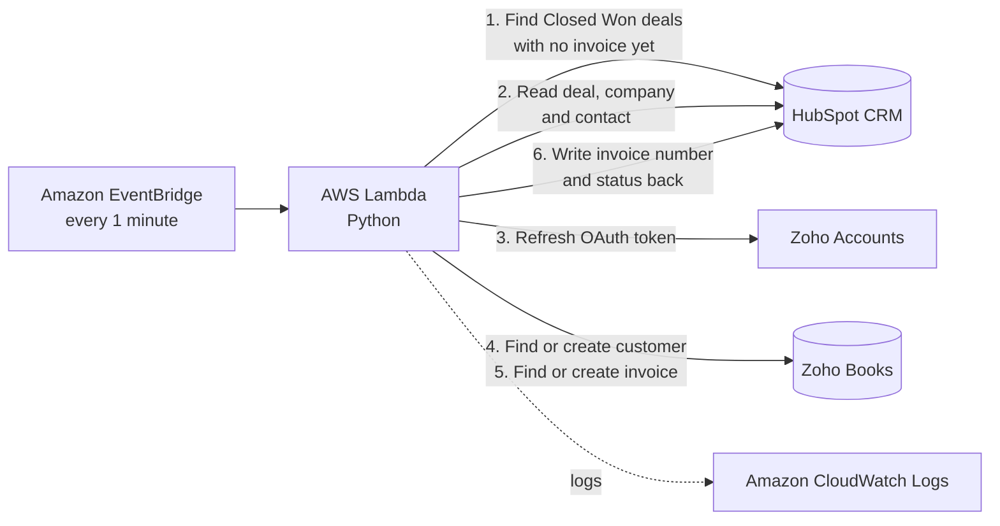

# Quote-to-Cash Sync: HubSpot → Zoho Books

Turns **Closed Won deals in HubSpot** into **invoices in Zoho Books** automatically, then writes the invoice number and status back onto the deal.

Built in Python on **AWS Lambda**, triggered every minute by **Amazon EventBridge**.

## The problem

In many small businesses, winning a deal starts a manual handoff. Sales tells finance, and finance re-types the customer and deal details into the accounting system. That can take up to a business day, and re-keying data causes typos and duplicate customers.

This integration removes the handoff: an invoice appears in Zoho Books within a minute or two of the deal closing, and the salesperson can see its number on the deal without leaving HubSpot.

## How it works

1. EventBridge triggers the Lambda every minute.
2. The Lambda searches HubSpot for deals in **Closed Won** that have no `zoho_invoice_number` yet.
3. For each deal, it reads the deal, its associated company and its contact.
4. It exchanges a Zoho refresh token for a short-lived access token.
5. It finds the customer in Zoho Books by email, or creates them.
6. It creates an invoice with the reference `HS-<deal ID>`, unless one already exists.
7. It writes the invoice number and status back to the HubSpot deal, which also stops the deal from being picked up again.

## Design decisions

**Polling instead of webhooks.** New HubSpot accounts can no longer create legacy private apps, and HubSpot's replacement, Service Keys, doesn't support webhooks. Polling every minute with a "not yet invoiced" filter needs no public endpoint to secure, and any deal that fails is retried automatically on the next run. The trade-off is up to a minute of delay.

**Idempotency.** The same deal can safely be processed more than once. Customers are matched by email, and invoices are matched by their `HS-<deal ID>` reference. Re-running never creates a duplicate customer or invoice.

**Email is the matching key, not the company name.** Names vary between systems ("Acme Ltd" vs "Acme Limited"), but an email address identifies one person reliably.

**Failure isolation.** If one deal fails, for example because it has no contact, the error is logged and the other deals still go through. The failed deal is picked up again on the next run.

**Secrets stay out of code and logs.** All credentials come from Lambda environment variables. Error messages strip URL query strings, because the Zoho token request carries the client secret in its query string. In production, AWS Secrets Manager would be the next step.

**No external dependencies.** Only the Python standard library is used, so deployment is a single file with nothing to package.

## Setup

### Prerequisites

- A HubSpot account with a **Service Key** that has these scopes: `crm.objects.deals.read`, `crm.objects.deals.write`, `crm.objects.contacts.read`, `crm.objects.companies.read`
- A Zoho Books organization and a **Self Client** in the Zoho API Console, with the scopes `ZohoBooks.contacts.ALL,ZohoBooks.invoices.ALL`
- An AWS account

### HubSpot

Create two deal properties (Settings → Properties → Deal properties), both **Single-line text**:

| Label | Internal name |
|---|---|
| Zoho Invoice Number | `zoho_invoice_number` |
| Zoho Payment Status | `zoho_payment_status` |

### Zoho Books

Generate a grant code from the Self Client, exchange it for a refresh token at `https://accounts.zoho.com/oauth/v2/token`, and note your organization ID. If your organization is on another data centre (for example `.eu` or `.in`), use that domain in the URLs below.

### AWS Lambda

1. Create a function with the latest **Python 3** runtime and paste in `lambda_function.py`.
2. Set the timeout to **30 seconds** (Configuration → General configuration).
3. Add these environment variables:

| Variable | Value |
|---|---|
| `HUBSPOT_TOKEN` | HubSpot Service Key |
| `ZOHO_CLIENT_ID` | Zoho Self Client ID |
| `ZOHO_CLIENT_SECRET` | Zoho Self Client secret |
| `ZOHO_REFRESH_TOKEN` | Zoho refresh token |
| `ZOHO_ORG_ID` | Zoho Books organization ID |
| `ZOHO_ACCOUNTS_URL` | `https://accounts.zoho.com` |
| `ZOHO_API_URL` | `https://www.zohoapis.com` |

4. Add an **EventBridge** trigger with the schedule expression `rate(1 minute)`.

## Testing

| Test | Event | Expected result |
|---|---|---|
| One deal | `events/manual-deal.json` with a real deal ID | Invoice created and its number written to the deal |
| Scheduled run | `events/scheduled-run.json` | Lists Closed Won deals without an invoice and processes them |
| Idempotency | Run the same deal twice | Second run logs "Invoice already exists" with the same invoice number |

## Limitations and roadmap

- **Payment sync back:** update `zoho_payment_status` in HubSpot when the invoice is paid in Zoho Books (planned).
- **Line items:** each invoice currently has one line for the deal amount. Mapping HubSpot line items to Zoho Books items is planned.
- **Tax:** no tax is applied to invoice lines yet.
- **Real-time trigger:** a HubSpot project-based app with webhooks would make invoicing near-instant instead of up to a minute.
- **Secrets:** move credentials from environment variables to AWS Secrets Manager.
- **Volume:** each run processes up to 20 deals.

## Tech stack

Python · AWS Lambda · Amazon EventBridge · Amazon CloudWatch · HubSpot CRM API v3 · Zoho Books API v3 · OAuth 2.0

## Documentation

- [Discovery document](docs/discovery.md): the business problem, requirements and design decisions behind this integration
